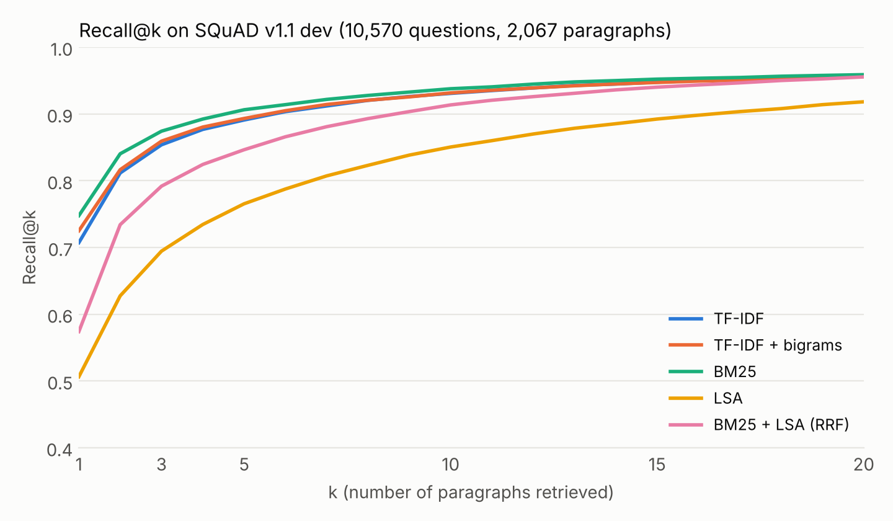
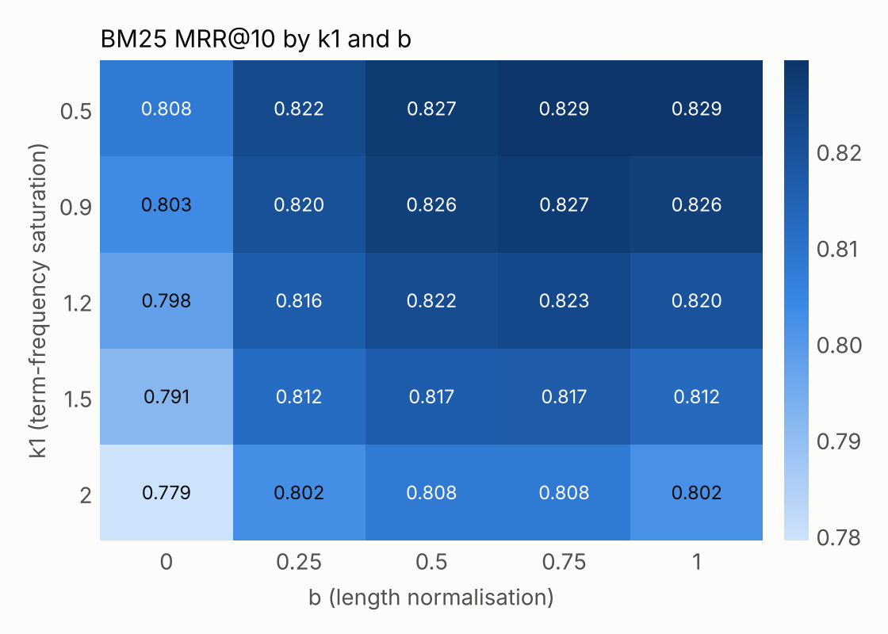

# rag-retrieval-bench

A small, reproducible benchmark for the **retrieval step of a RAG pipeline**. It measures how often a retriever puts the paragraph containing the answer in the top-k results, using the 10,570 questions and 2,067 paragraphs of the SQuAD v1.1 dev set.

It compares five retrievers behind one two-method interface (`fit`, `score`), all implemented from scratch on NumPy/SciPy/scikit-learn, with no model downloads and no API keys:

| Retriever | What it is |
| --- | --- |
| TF-IDF | Cosine similarity over sublinear TF-IDF vectors |
| TF-IDF + bigrams | Same, with unigrams and bigrams |
| BM25 | Okapi BM25 (Lucene-style IDF), written with sparse matrix algebra |
| LSA | TF-IDF, then 256-dimensional truncated SVD: a model-free stand-in for dense retrieval |
| BM25 + LSA (RRF) | Reciprocal Rank Fusion of BM25 and LSA |

The repo also contains a pluggable dense retriever and a score-fusion hybrid, plus a script for running them with a sentence-transformers model (see [Dense retrieval](#dense-retrieval-not-yet-run)).

## Results

Single relevant paragraph per question, 10,570 questions, ranking over all 2,067 paragraphs.

| Retriever | Recall@1 | Recall@3 | Recall@5 | Recall@10 | MRR@10 | nDCG@10 |
| --- | --- | --- | --- | --- | --- | --- |
| TF-IDF | 0.707 | 0.854 | 0.891 | 0.931 | 0.788 | 0.823 |
| TF-IDF + bigrams | 0.725 | 0.859 | 0.893 | 0.932 | 0.798 | 0.831 |
| **BM25** | **0.748** | **0.874** | **0.906** | **0.938** | **0.817** | **0.847** |
| LSA | 0.507 | 0.695 | 0.766 | 0.851 | 0.617 | 0.673 |
| BM25 + LSA (RRF) | 0.574 | 0.792 | 0.847 | 0.914 | 0.695 | 0.748 |



### What the numbers say

- **BM25 is the strongest retriever here**, ahead of TF-IDF by 4.1 points of Recall@1 and 2.9 points of MRR@10. Bigrams help TF-IDF a little (+1.8 points Recall@1) but do not close the gap.
- **Fusion with a weaker retriever hurt, and how you fuse matters.** Adding LSA to BM25 through RRF lowered Recall@1 from 0.748 to 0.574, and every non-zero LSA weight I tried scored below BM25 alone. Fusing z-scored scores instead degrades much more gently (0.746 at LSA weight 0.1, 0.718 at equal weights) but still never beats BM25 alone (`results/fusion_sweep.md`). Rank-based fusion throws away how far apart documents are in each retriever's scores, so a clearly weaker ranker mostly adds noise. Hybrid search needs a second retriever that is competitive, not just different.
- **Most misses are the right article, wrong paragraph.** Of BM25's 2,665 Recall@1 misses, 75.8% have a top-1 paragraph from the correct article, and only 3.6% have a gold paragraph with no indexed term in common with the question (`results/bm25_miss_analysis.md`). The hard part of this task is choosing between neighbouring paragraphs on the same topic, not finding the topic.
- **Question type barely matters for lexical retrieval.** BM25 Recall@1 stays between 0.709 (`where`) and 0.753 (`when`, `how`) across question types with 400+ examples (`results/recall1_by_question_type.md`).
- **BM25 parameters matter less than the choice of BM25.** Across a 5x5 grid, MRR@10 ranges from 0.779 to 0.829 (default k1=1.5, b=0.75 gives 0.817). Switching length normalisation off (b=0) is consistently the worst setting.



## Read this before quoting the numbers

- **The corpus is small and the questions are easy for lexical search.** SQuAD annotators wrote each question while looking at its paragraph, so questions share many words with their answer paragraph. These scores are not comparable to BEIR or MS MARCO, and they say little about how BM25 would do on a large, noisy corpus.
- **LSA is not a neural dense retriever.** It is a cheap latent-semantic baseline. A trained embedding model would very likely do better than LSA, and may help in a hybrid. The experiment is implemented (`scripts/run_dense.py`) but I have not run it with a neural model yet, so this repo has no dense results.
- **The k1/b grid and the fusion-weight sweeps are evaluated on the same questions as the headline table.** Treat the best cells as optimistic. The headline BM25 row uses the default parameters, not the tuned ones.
- **Ties are scored pessimistically.** If the gold paragraph ties with other paragraphs (for example, all-zero scores), it is ranked below all of them.
- **One gold paragraph per question.** A different paragraph that also answers the question is counted as a miss.

## Quickstart

```bash
python -m venv .venv && source .venv/bin/activate
pip install -e ".[dev]"

python scripts/download_data.py      # SQuAD v1.1 dev, checksum-verified
python -m ragbench.run               # tables, CSVs and ranks in ./results
python -m ragbench.plots             # figures in ./results
python scripts/miss_analysis.py      # BM25 failure breakdown
pytest                               # 21 unit tests
```

`python -m ragbench.run --limit 500 --skip-grid` gives a quick sanity run. All numbers are deterministic (fixed seeds, fixed dataset checksum).

## Method

- **Documents**: every SQuAD paragraph (2,067). **Queries**: every question (10,570). **Gold**: the paragraph the question was written about.
- **Tokenisation**: lowercase, `\b\w+\b`, English stop words removed.
- **BM25**: `idf = ln(1 + (N - df + 0.5) / (df + 0.5))`, term weight `tf * (k1 + 1) / (tf + k1 * (1 - b + b * len / avglen))`. Verified against a hand-computed score in `tests/test_retrievers.py`.
- **RRF**: `score(d) = sum_r w_r / (60 + rank_r(d))`.
- **Score fusion**: `score(d) = sum_r w_r * z_r(d)`, where `z_r` standardises retriever r's scores across documents for each query.
- **Dense retriever**: cosine similarity between embeddings from any `encode(list[str]) -> array` function. Embeddings are cached by text, so sweeps do not re-encode.
- **Metrics**: with one relevant document per query, everything is a function of its 1-based rank: Recall@k = share of queries with rank <= k, MRR@10 = mean of 1/rank (0 beyond 10), nDCG@10 = mean of 1/log2(rank + 1) (0 beyond 10).

## Layout

```
src/ragbench/
  data.py        SQuAD loader, question-type tagging
  retrievers.py  TF-IDF, BM25, LSA, dense, RRF and score fusion behind fit()/score()
  dense_experiment.py  BM25 vs dense vs fusion for any embedding function
  metrics.py     rank-based Recall@k, MRR@k, nDCG@k
  evaluate.py    benchmark loop, per-question-type breakdown
  run.py         CLI: all tables and CSVs
  plots.py       figures
scripts/         dataset download, BM25 miss analysis, sentence-transformers experiment
tests/           21 unit tests (metrics, retrievers, fusion, dense, data loader)
results/         committed outputs from the run described above
```

## Dense retrieval (not yet run)

```bash
pip install -e ".[dense]"
python scripts/run_dense.py --model sentence-transformers/all-MiniLM-L6-v2
```

This compares BM25, the dense model, RRF and score fusion at several dense weights, and writes `results/dense_<model>.csv` and `.md`. It needs a one-off model download from Hugging Face and a few minutes of encoding on CPU. The code path is covered by unit tests with a stand-in encoder, but no neural-model results are included yet.

## Roadmap

- Run the dense experiment above and add its results and a short write-up.
- Add a cross-encoder reranker on the top 20 and measure the lift on the "right article, wrong paragraph" misses.
- Chunk-size ablation: sentence windows aggregated to paragraph scores.
- Run the same harness on a larger corpus (for example a BEIR dataset) to see whether the ranking of retrievers holds.

## License

MIT
